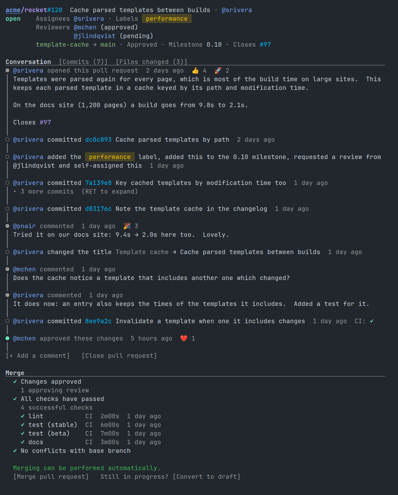

# octocat.el

> [!NOTE]
> **Written with LLM assistance.** Most of this project was written with
> the help of Claude.  Every source file names the models that worked on
> it in an `Assisted-by:` header line, per the
> [MELPA attribution convention](https://github.com/melpa/melpa/blob/master/CONTRIBUTING.org).

A GitHub client for Emacs, powered by the [`gh`](https://cli.github.com/) command-line tool.

Browse repositories, review and merge pull requests, triage issues and
watch Actions runs, all in Emacs buffers that read like GitHub's own
pages:

- **Dashboard** — the PRs and issues that involve you, your repos, your feed
- **Repositories** — files, branches, commits, the README (markdown or org), a tree browser
- **Pull requests** — conversation, reviews, checks, diffs, merging
- **Issues** — lists filtered by GitHub search, comments, new issues
- **Actions** — runs, jobs and their logs, workflows

With `octocat-github-links-mode` on, github.com links open in octocat
wherever you follow them in Emacs.



See [every page](docs/screenshots/README.md), drawn from made-up data.

## Getting started

You need:

- **Emacs 29.1 or later**, built with SQLite (`(sqlite-available-p)`
  returns `t`).  On Emacs 29 it also needs JSON support
  (`(json-available-p)`); Emacs 30 and later always have it.  HTML in
  READMEs, issues and comments is read with libxml2
  (`(libxml-available-p)`), which Emacs builds with whenever it finds
  the library; without it, that HTML shows as its source.
- **[`gh`](https://cli.github.com/)**, installed (`brew install gh`,
  `apt install gh`, `winget install GitHub.cli`) and logged in with
  `gh auth login`.  Octocat looks for it on `exec-path`, then in the
  Homebrew and MacPorts directories; set `octocat-gh-program` to its
  file name if it is elsewhere.
- **[vui.el](https://melpa.org/#/vui)**, from MELPA.

Then clone this repository and load it:

```emacs-lisp
(add-to-list 'load-path "/path/to/octocat.el")
(require 'octocat)
```

Optional extras:

```emacs-lisp
;; Open github.com links from anywhere in Emacs in octocat
(octocat-github-links-mode 1)

;; Doom Emacs: let `q' step back to octocat pages
(add-hook 'doom-real-buffer-functions #'octocat-buffer-p)
```

| Command | Opens |
|---------|-------|
| `M-x octocat` | Your dashboard |
| `M-x octocat-repo` | The repository of the current Git clone |
| `M-x octocat-pr-list` / `octocat-issue-list` | Its pull requests / issues |
| `M-x octocat-actions` | Its workflow runs |

[Using octocat.el](docs/usage.md) walks through every page.

## Keybindings

| Key | Action |
|-----|--------|
| `RET` | Open the thing at point, or edit the field at point |
| `S-RET` | The same, in another window (Evil: `O`, and `o` is `RET`) |
| `q` | Back to the previous page, or out of octocat |
| `TAB` / `S-TAB` | Fold the section at point / all sections |
| `g` / `gr` | Refresh the page |
| `C-c C-o` | Open the thing at point on GitHub |
| `M-x octocat-copy-url` | Copy its URL instead (`C-u`: its short reference, as `owner/repo#12`) |
| `C-c C-j` | Jump to a PR, issue, commit, workflow or file (`C-u`: another repo or user) |
| `C-c C-v` | Another view: raw markdown or org, compact lists, review comments in diffs |
| `C-c C-a` | Comment on a PR or issue |
| `C-c C-e` | Edit the title, body, comment, labels, assignees or reviewers at point |
| `C-c C-l` | React to the PR, issue or comment at point, or take a reaction back |
| `C-c C-n` | Write a new issue |
| `C-c C-r` | Review the PR |
| `C-c C-m` | Merge the PR |
| `C-c C-b` | Show another branch |
| `C-c C-f` | Find a file in the repository |
| `C-c C-l` | History of the file shown |

Some keys do more than fits here; see [Keys in more
depth](docs/usage.md#keys-in-more-depth).

## More

- [Using octocat.el](docs/usage.md) — every page, in detail
- [Screenshots](docs/screenshots/README.md) — every page, pictured
- [CHANGELOG.md](CHANGELOG.md) — what changed in each release
- [CONTRIBUTING.md](CONTRIBUTING.md) — code conventions, building, testing, CI

`M-x octocat-doctor` reports, as text to paste into a bug report, which
files are loaded (and whether a compiled one is stale), the store's size
and largest resources, which pages refresh on their own and why, and
the requests to GitHub of the last hour: how many, how often, and how
much data they brought in.  It names the resources it
stores, but not your token.

## License

[GNU General Public License](LICENSE).
