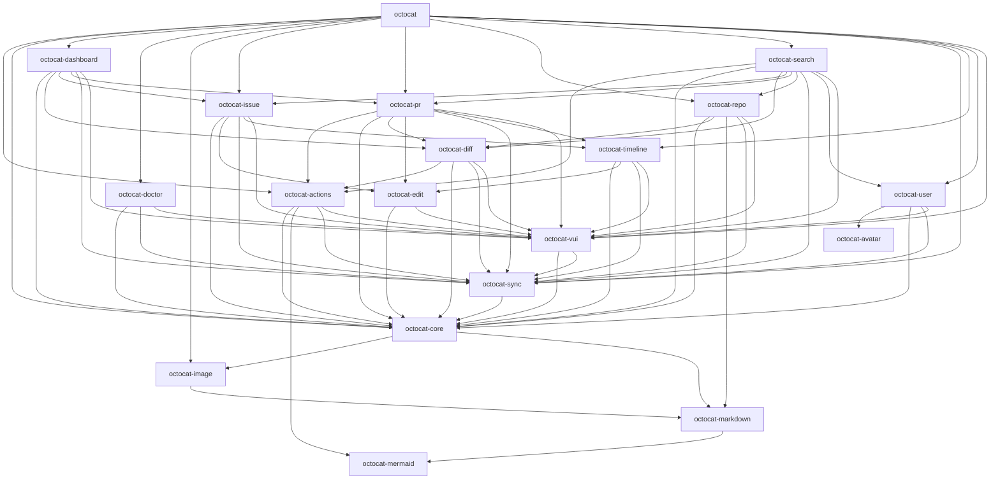
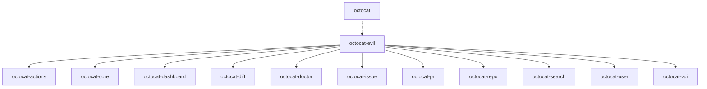

# Architecture

octocat.el is split into one file per module.  `octocat.el` is the
package's main file: it holds every `;;;###autoload` entry point and
requires every other module, so whatever a user runs has all of them
loaded (see "Entry points" in [CONTRIBUTING.md](../CONTRIBUTING.md)).

## Layers

From the bottom up:

- **Standalone renderers**: `octocat-mermaid` and `octocat-avatar`
  require no other module, so they can be loaded and tested on their
  own.  `octocat-markdown`, which also turns org into markdown, and
  `octocat-image` build on them to draw GitHub's markdown.
- **`octocat-core`**: running `gh`, faces, and the helpers every page
  shares.
- **`octocat-sync`**: the local SQLite store pages read from, and the
  syncing that fills it (see "Refresh and the sync store" in
  CONTRIBUTING.md).
- **`octocat-vui`**: components and helpers on top of vui.el, and the
  branch and repo pickers.
- **Shared parts of pages**: `octocat-edit`, `octocat-timeline`.
- **Pages**: one module per kind of page, or per group of related
  pages, such as `octocat-pr` (a PR's conversation, commits and files
  changed), `octocat-issue`, `octocat-repo` (a repository's code),
  `octocat-actions` (GitHub Actions and a commit's checks) or
  `octocat-diff` (the changed files of a diff, and the commit and
  compare pages), requiring the pages they link to.
  `octocat-search` and `octocat-dashboard` (the page `M-x octocat`
  opens) sit above the pages their rows open.
- **`octocat-evil`**: Evil bindings, loaded only once Evil is on.  It
  requires the pages it binds keys in, which `octocat.el` has loaded
  by then.

Requires must not form a cycle.  Where a lower module opens a page of
a higher one, or a page opens a peer it cannot require, it calls
`octocat-open` with the page's kind, such as `(octocat-open 'pr repo
number)`: a generic function in `octocat-core` that each page module
adds a `cl-defmethod` to for its kinds.  A key bound to a higher
module's command names it quoted, as `'octocat-jump`, not `#'`.

A lower module never names a higher one's function otherwise.  What it
needs from above, the caller hands it:

- bound around the call, as core binds the link handlers and host
  around `octocat-markdown-render`, which each link keeps;
- set buffer-locally by the page's mode, as the repo and file pages
  set the functions `octocat-image` fetches a repository's images with;
- added to a hook from a function the higher module runs anyway, as
  `octocat-vui--listen` adds vui's handlers to sync's and image's
  hooks when a page mounts.

## Module graph

An arrow points from a module to one it requires.  A dashed one is a
`require` inside a function, run only when it is called.  Every
`require` is drawn, even one a longer path already implies, so the
graph shows each module's real dependencies.  `octocat-evil` is left
out: it requires every page it binds keys in, so it has a graph of its
own, below.

<!-- module-graph -->

<!-- /module-graph -->

### Evil bindings

`octocat.el` loads `octocat-evil` only once Evil is on.

<!-- evil-graph -->

<!-- /evil-graph -->

## Modules

<!-- module-list -->
| Module | What it is | Requires |
|---|---|---|
| `octocat-actions` | GitHub Actions and commit checks for octocat | `octocat-core`, `octocat-mermaid`, `octocat-sync`, `octocat-vui` |
| `octocat-avatar` | Draw an avatar image as coloured ASCII art |  |
| `octocat-core` | Shared infrastructure for octocat | `octocat-image`, `octocat-markdown` |
| `octocat-dashboard` | GitHub account dashboard for octocat | `octocat-core`, `octocat-diff`, `octocat-issue`, `octocat-pr`, `octocat-sync`, `octocat-vui` |
| `octocat-diff` | Diffs, commits and comparisons for octocat | `octocat-actions`, `octocat-core`, `octocat-sync`, `octocat-vui` |
| `octocat-doctor` | Report on octocat's code, store and requests | `octocat-core`, `octocat-sync`, `octocat-vui` |
| `octocat-edit` | Edit buffer for octocat PRs and issues | `octocat-core`, `octocat-vui` |
| `octocat-evil` | Evil keybindings for octocat | `octocat-actions`, `octocat-core`, `octocat-dashboard`, `octocat-diff`, `octocat-doctor`, `octocat-issue`, `octocat-pr`, `octocat-repo`, `octocat-search`, `octocat-user`, `octocat-vui` |
| `octocat-image` | Show images uploaded to GitHub in markdown | `octocat-markdown` |
| `octocat-issue` | Issue detail view for octocat | `octocat-core`, `octocat-edit`, `octocat-sync`, `octocat-timeline`, `octocat-vui` |
| `octocat-markdown` | GitHub markdown renderer | `octocat-mermaid` |
| `octocat-mermaid` | Draw mermaid diagrams as text |  |
| `octocat-pr` | Pull Request detail view for octocat | `octocat-actions`, `octocat-core`, `octocat-diff`, `octocat-edit`, `octocat-sync`, `octocat-timeline`, `octocat-vui` |
| `octocat-repo` | Repository overview, tree, files and history for octocat | `octocat-core`, `octocat-diff`, `octocat-markdown`, `octocat-sync`, `octocat-vui` |
| `octocat-search` | Repo-wide PR, issue and commit search for octocat | `octocat-actions`, `octocat-core`, `octocat-diff`, `octocat-issue`, `octocat-pr`, `octocat-repo`, `octocat-sync`, `octocat-user`, `octocat-vui` |
| `octocat-sync` | Sync GitHub data into a local SQLite store | `octocat-core` |
| `octocat-timeline` | GitHub-style timeline for issue and PR views | `octocat-core`, `octocat-edit`, `octocat-sync`, `octocat-vui` |
| `octocat-user` | GitHub user / organization page for octocat | `octocat-avatar`, `octocat-core`, `octocat-sync`, `octocat-vui` |
| `octocat-vui` | vui.el helpers and components for octocat | `octocat-core`, `octocat-sync` |
| `octocat` | GitHub Client powered by the gh CLI | `octocat-actions`, `octocat-core`, `octocat-dashboard`, `octocat-doctor`, `octocat-image`, `octocat-issue`, `octocat-pr`, `octocat-repo`, `octocat-search`, `octocat-sync`, `octocat-timeline`, `octocat-user`, `octocat-vui`, `octocat-evil` (lazily) |
<!-- /module-list -->

## Updating

`make update-architecture-md` rewrites the graph and the table above
from the `require` forms in the sources, read with Emacs's own reader,
and each file's title line.  `make lint` fails when they are out of date.  The
text around them is written by hand: change it when a module's place
in the layers changes.
