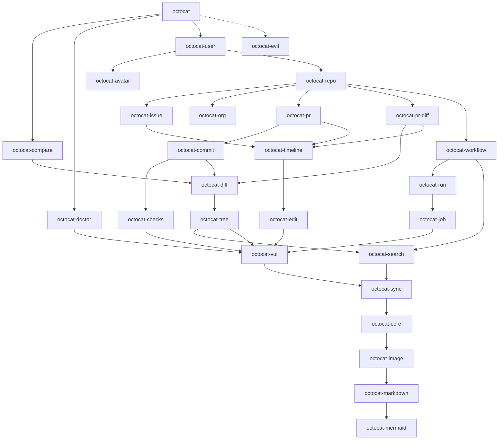

# Architecture

octocat.el is split into one file per module.  `octocat.el` is the
package's main file: it holds every `;;;###autoload` entry point and
requires every other module, so whatever a user runs has all of them
loaded (see "Entry points" in [CONTRIBUTING.md](../CONTRIBUTING.md)).

## Layers

From the bottom up:

- **Standalone renderers**: `octocat-mermaid`, `octocat-org` and
  `octocat-avatar` require no other module, so they can be loaded and
  tested on their own.  `octocat-markdown` and `octocat-image` build on
  them to draw GitHub's markdown.
- **`octocat-core`**: running `gh`, faces, and the helpers every page
  shares.
- **`octocat-sync`**: the local SQLite store pages read from, and the
  syncing that fills it (see "Refresh and the sync store" in
  CONTRIBUTING.md).
- **`octocat-vui`**: components and helpers on top of vui.el.
- **Shared parts of pages**: `octocat-diff`, `octocat-edit`,
  `octocat-timeline`, `octocat-search`.
- **Pages**: one module per kind of page, such as `octocat-pr`,
  `octocat-issue` or `octocat-repo`, requiring the pages they link to.
- **`octocat-evil`**: Evil bindings, loaded only once Evil is on.

Requires must not form a cycle.  Where a lower module calls into a
higher one, it does so through a variable or hook whose default the
higher module sets, or through a `declare-function` (see AGENTS.md).

## Module graph

An arrow points from a module to one it requires.  A dashed one is a
`require` inside a function, run only when it is called.  An arrow a
longer path already implies is left out, as nearly every module
requires `octocat-core`; the table below lists them all.

<!-- module-graph -->

<!-- /module-graph -->

## Modules

<!-- module-list -->
| Module | What it is | Requires |
|---|---|---|
| `octocat-avatar` | Draw an avatar image as coloured ASCII art |  |
| `octocat-checks` | Check-run detail view for octocat | `octocat-core`, `octocat-sync`, `octocat-vui` |
| `octocat-commit` | Commit detail view for octocat | `octocat-checks`, `octocat-core`, `octocat-diff`, `octocat-sync`, `octocat-vui` |
| `octocat-compare` | Compare view for octocat | `octocat-core`, `octocat-diff`, `octocat-sync`, `octocat-vui` |
| `octocat-core` | Shared infrastructure for octocat | `octocat-image`, `octocat-markdown` |
| `octocat-diff` | Diff rendering for octocat | `octocat-core`, `octocat-tree`, `octocat-vui` |
| `octocat-doctor` | Report on octocat's code, store and requests | `octocat-core`, `octocat-sync`, `octocat-vui` |
| `octocat-edit` | Edit buffer for octocat PRs and issues | `octocat-core`, `octocat-vui` |
| `octocat-evil` | Evil keybindings for octocat |  |
| `octocat-image` | Show images uploaded to GitHub in markdown | `octocat-markdown` |
| `octocat-issue` | Issue detail view for octocat | `octocat-core`, `octocat-edit`, `octocat-sync`, `octocat-timeline`, `octocat-vui` |
| `octocat-job` | Job detail view for octocat | `octocat-core`, `octocat-sync`, `octocat-vui` |
| `octocat-markdown` | GitHub markdown renderer | `octocat-mermaid` |
| `octocat-mermaid` | Draw mermaid diagrams as text |  |
| `octocat-org` | Turn org text into GitHub markdown |  |
| `octocat-pr-diff` | PR diff view for octocat | `octocat-core`, `octocat-diff`, `octocat-edit`, `octocat-sync`, `octocat-timeline`, `octocat-vui` |
| `octocat-pr` | Pull Request detail view for octocat | `octocat-checks`, `octocat-commit`, `octocat-core`, `octocat-edit`, `octocat-sync`, `octocat-timeline`, `octocat-vui` |
| `octocat-repo` | Per-repository view for octocat | `octocat-checks`, `octocat-commit`, `octocat-core`, `octocat-issue`, `octocat-job`, `octocat-org`, `octocat-pr`, `octocat-pr-diff`, `octocat-run`, `octocat-search`, `octocat-tree`, `octocat-vui`, `octocat-workflow` |
| `octocat-run` | Workflow run detail view for octocat | `octocat-core`, `octocat-job`, `octocat-mermaid`, `octocat-sync`, `octocat-vui` |
| `octocat-search` | Repo-wide PR, issue and commit search for octocat | `octocat-core`, `octocat-sync` |
| `octocat-sync` | Sync GitHub data into a local SQLite store | `octocat-core` |
| `octocat-timeline` | GitHub-style timeline for issue and PR views | `octocat-core`, `octocat-edit`, `octocat-sync`, `octocat-vui` |
| `octocat-tree` | File tree and file log browser for octocat | `octocat-core`, `octocat-search`, `octocat-sync`, `octocat-vui` |
| `octocat-user` | GitHub user / organization page for octocat | `octocat-avatar`, `octocat-core`, `octocat-repo`, `octocat-sync`, `octocat-vui` |
| `octocat-vui` | vui.el helpers and components for octocat | `octocat-core`, `octocat-sync` |
| `octocat-workflow` | Workflow detail view for octocat | `octocat-core`, `octocat-run`, `octocat-search`, `octocat-sync`, `octocat-vui` |
| `octocat` | GitHub Client powered by the gh CLI | `octocat-checks`, `octocat-commit`, `octocat-compare`, `octocat-core`, `octocat-doctor`, `octocat-image`, `octocat-issue`, `octocat-job`, `octocat-pr`, `octocat-pr-diff`, `octocat-repo`, `octocat-run`, `octocat-search`, `octocat-sync`, `octocat-timeline`, `octocat-tree`, `octocat-user`, `octocat-vui`, `octocat-workflow`, `octocat-evil` (lazily) |
<!-- /module-list -->

## Updating

`make update-architecture-md` rewrites the graph and the table above
from the `require` forms in the sources, read with Emacs's own reader,
and each file's title line.  `make lint` fails when they are out of date.  The
text around them is written by hand: change it when a module's place
in the layers changes.
