# Screenshots

What octocat.el's pages look like, drawn from made-up data: the `acme`
organization, its `rocket` repository, its people and its hashes are
all invented.  Each shot is also kept as plain text, linked as *As
text*, to read or diff.

`make screenshots` redraws them all; see [Updating](#updating).

## Dashboard

`M-x octocat`: the open pull requests and issues that involve you, your
recent repositories and the activity feed.

<!-- screenshot: (dashboard) -->
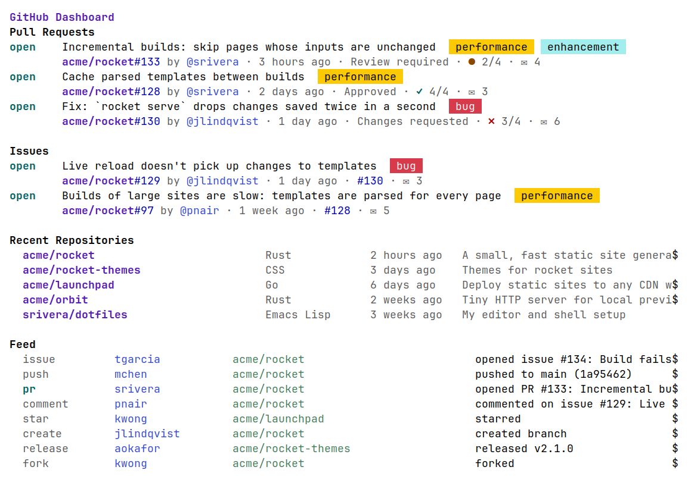

[As text](dashboard.txt)
<!-- /screenshot -->

## Repository

`M-x octocat-repo`: the repository's files at a branch, its last commit,
and its README.

<!-- screenshot: (visit-repo "acme/rocket") :name "repo" -->
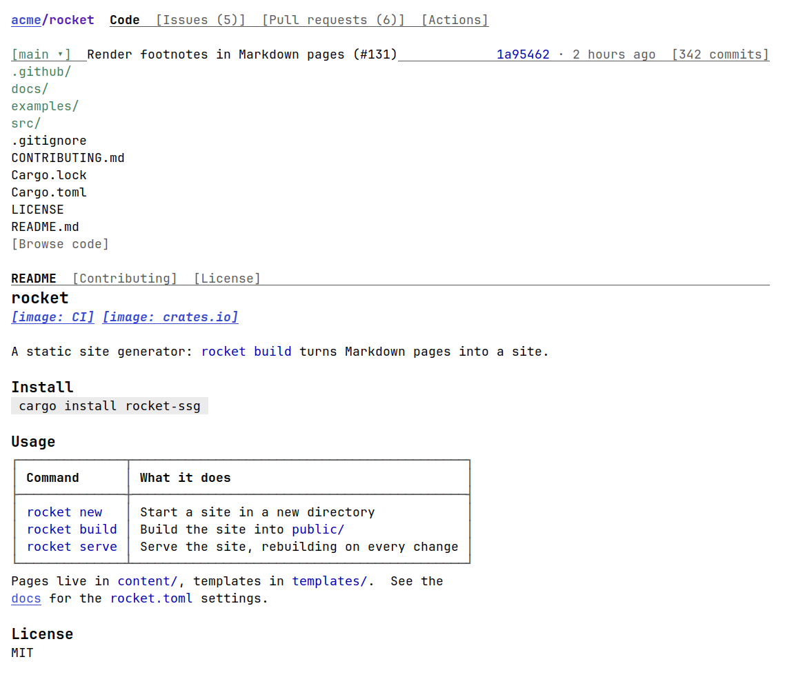

[As text](repo.txt)
<!-- /screenshot -->

The tree browser, opened at `src/`:

<!-- screenshot: (tree "acme/rocket" nil "src") -->
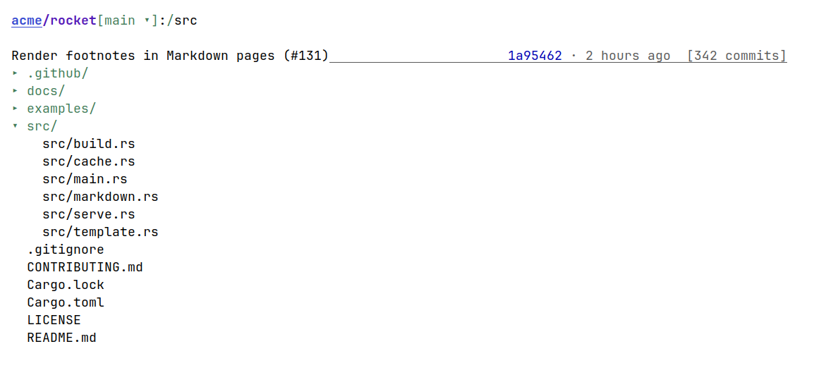

[As text](tree.txt)
<!-- /screenshot -->

A file, from the tree, here a Markdown one, rendered: the top is the
tree browser's, and `[main ▾]` opens the file at another branch, in a
buffer of its own.

<!-- screenshot: (tree--open-file-by-path "acme/rocket" "main" "docs/guide.md") :name "file" -->
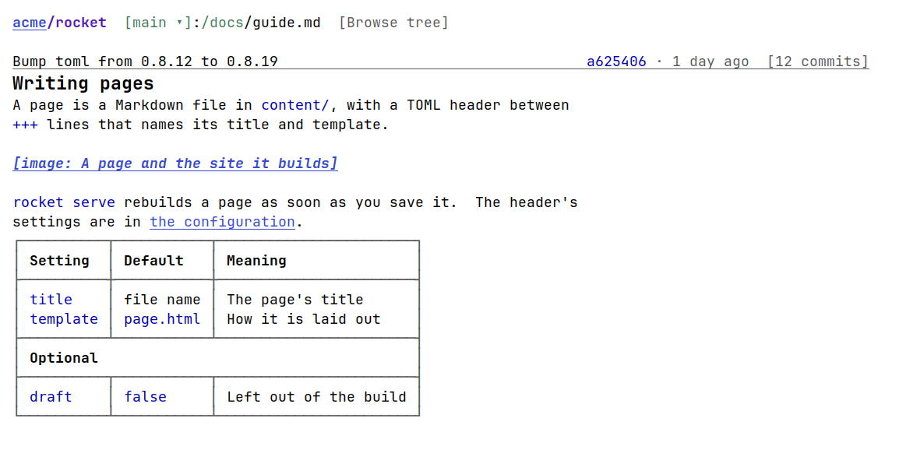

[As text](file.txt)
<!-- /screenshot -->

`[342 commits]` lists the history of the branch:

<!-- screenshot: (commit-list "acme/rocket") -->
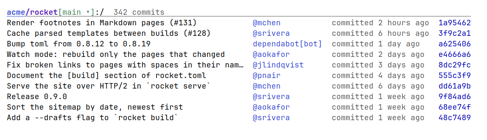

[As text](commit-list.txt)
<!-- /screenshot -->

## Pull requests

`M-x octocat-pr-list`: the open pull requests, filtered by a GitHub
search.

<!-- screenshot: (pr-list "acme/rocket") -->
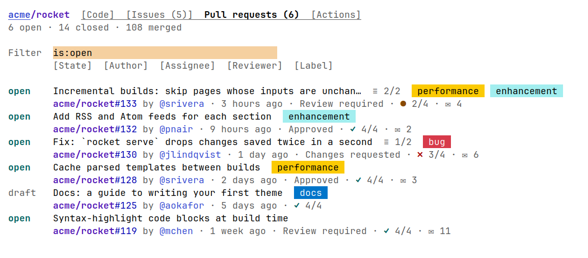

[As text](pr-list.txt)
<!-- /screenshot -->

A pull request: its conversation, reviews, commits and what stands
between it and a merge.

<!-- screenshot: (pr "acme/rocket" 128) -->

[As text](pr.txt)
<!-- /screenshot -->

Its changed files, with `[Expand all]` pressed:

<!-- screenshot: (pr-diff "acme/rocket" 128) :press ("Expand all") -->
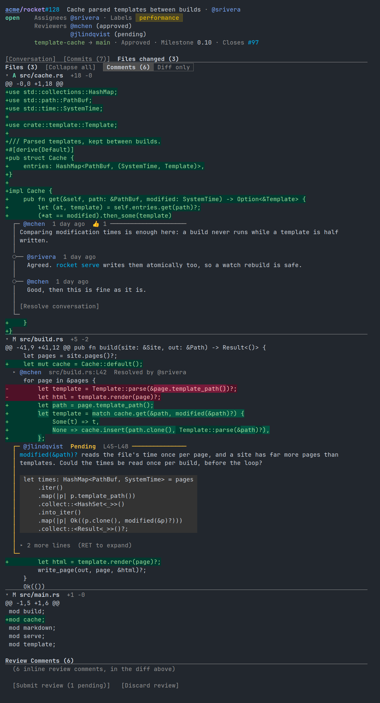

[As text](pr-diff.txt)
<!-- /screenshot -->

## Issues

`M-x octocat-issue-list`:

<!-- screenshot: (issue-list "acme/rocket") -->
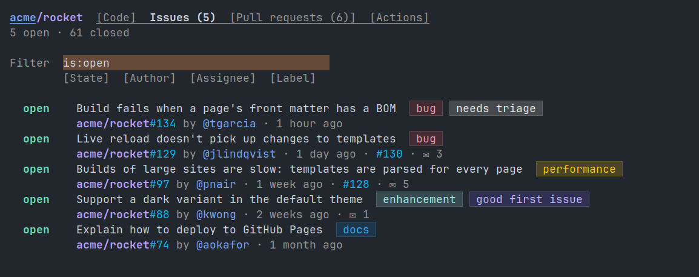

[As text](issue-list.txt)
<!-- /screenshot -->

An issue, and the pull request that will close it:

<!-- screenshot: (issue "acme/rocket" 97) -->
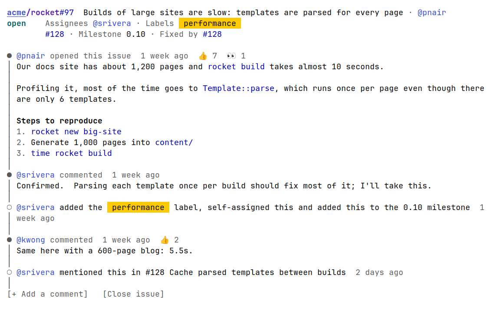

[As text](issue.txt)
<!-- /screenshot -->

## Commit

A commit: who wrote and committed it and when, as `git show` prints
them, its message, its checks and its files.

<!-- screenshot: (commit "acme/rocket" "3f9c2a1e8b7d6c5f4a3b2c1d0e9f8a7b6c5d4e3f") -->
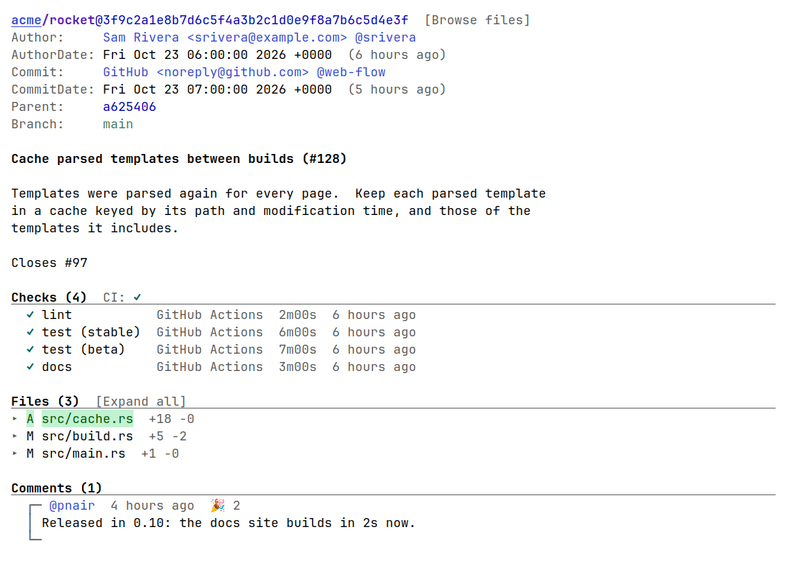

[As text](commit.txt)
<!-- /screenshot -->

## Actions

`M-x octocat-run-list` (or `M-x octocat-actions`): the recent workflow
runs, filterable.

<!-- screenshot: (run-list "acme/rocket") -->
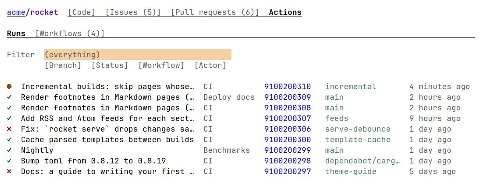

[As text](run-list.txt)
<!-- /screenshot -->

`M-x octocat-workflow-list`: the workflows, and whether each is enabled.

<!-- screenshot: (workflow-list "acme/rocket") -->
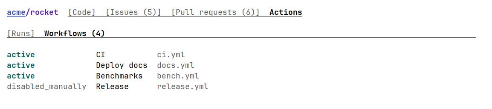

[As text](workflow-list.txt)
<!-- /screenshot -->

A run's jobs and artifacts:

<!-- screenshot: (run "acme/rocket" 9100200300) -->
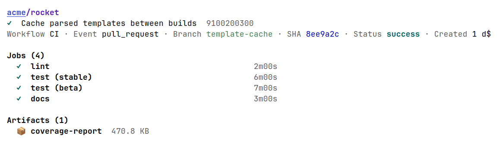

[As text](run.txt)
<!-- /screenshot -->

A job's steps, with `Run cargo` unfolded to its log:

<!-- screenshot: (job "acme/rocket" 9100200300 27100200300 "test (stable)") :press ("Run cargo") -->
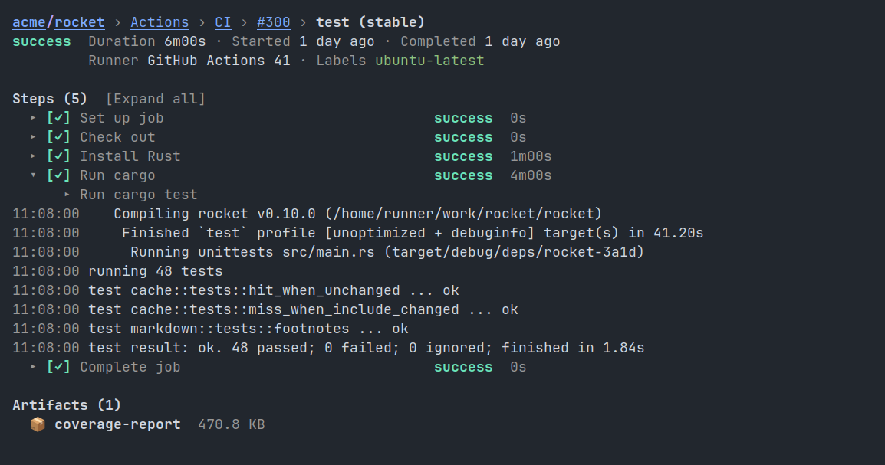

[As text](job.txt)
<!-- /screenshot -->

A workflow and its runs:

<!-- screenshot: (workflow "acme/rocket" 4200 "CI" ".github/workflows/ci.yml") -->
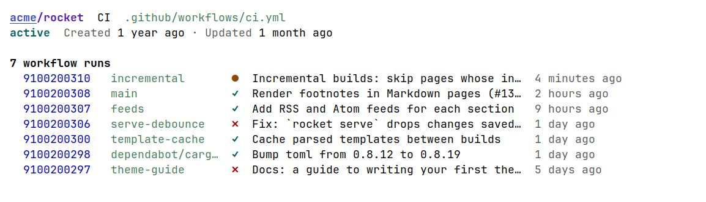

[As text](workflow.txt)
<!-- /screenshot -->

## User

`M-x octocat-user`: a user's profile, avatar, pinned and recent
repositories.

<!-- screenshot: (user "srivera") -->
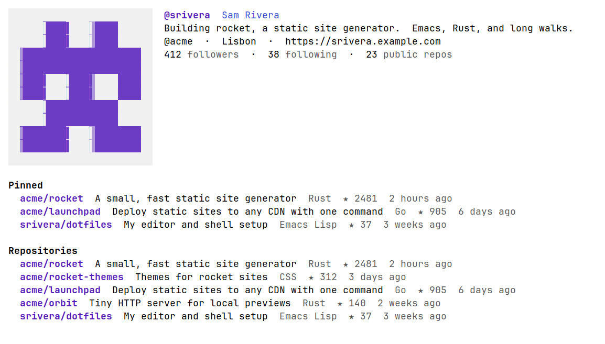

[As text](user.txt)
<!-- /screenshot -->

## Updating

`make screenshots` opens each page in a GUI Emacs under a virtual X
display, in a container, and rewrites every shot here: its PNG and its
text, beside this file.  It takes about 15 seconds, compiling first.

- **A shot** is a `<!-- screenshot: PAGE ... -->` marker, followed by
  what `make screenshots` writes, up to `<!-- /screenshot -->`.  PAGE
  is `(COMMAND ARGS...)`, opened by `octocat-COMMAND-open`, or by
  `octocat-COMMAND` when there is none, as `(pr-list "acme/rocket")`;
  `(dashboard)` is `M-x octocat`.  `:press ("Expand all")` presses
  buttons first, by their text; `:name` names its files, by default
  COMMAND.  To add a shot, add a marker.
- **The data** is in [test/screenshots/fixtures.el](../../test/screenshots/fixtures.el):
  what `gh` prints for each call the pages make, in GitHub's own JSON.
  Only the `gh` process is replaced, so the pages parse and store it as
  they would GitHub's answer.  A page making a call it lacks fails
  `make screenshots`, naming the call.  Keep it made up: no real
  repositories, people or hashes.
- **Avatars** are all drawn from
  [test/screenshots/avatar.png](../../test/screenshots/avatar.png), a
  made-up identicon; other images don't load.
- **The clock** is frozen at 2026-10-23 12:00 UTC, so ages don't change
  from run to run.
